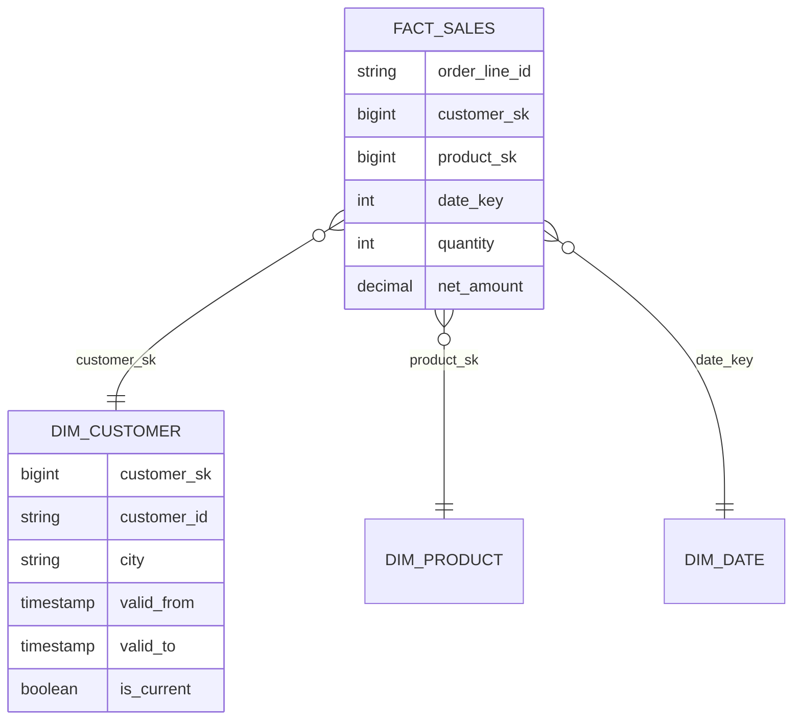

# 17. Lakehouse Data Modeling — SCD Types, Dimensional Design on Delta

## 1. Why modeling still matters on a lakehouse

Delta Lake gives you cheap storage, ACID transactions and schema enforcement, but it does not decide **how data should be shaped for the people who query it**. Gold-layer modeling determines whether analysts get consistent metrics and fast queries, or ten slightly different versions of "revenue". Dimensional modeling (Kimball) remains the most widely used approach for the Gold layer because it matches how the business asks questions: *measures* (facts) sliced by *context* (dimensions).

## 2. Dimensional building blocks

| Concept | Definition | Example |
|---|---|---|
| **Grain** | The exact meaning of one row in a fact table; decide this first | One row per order line |
| **Fact table** | Measurable events at a given grain, with foreign keys to dimensions | `fact_sales(order_line_id, date_key, customer_sk, product_sk, quantity, net_amount)` |
| **Dimension table** | Descriptive context used to filter, group and label | `dim_customer`, `dim_product`, `dim_date` |
| **Surrogate key** | Meaningless, stable integer key owned by the warehouse | `customer_sk` vs source `customer_id` |
| **Conformed dimension** | One shared dimension reused across fact tables and domains | The same `dim_date` and `dim_product` everywhere |
| **Degenerate dimension** | An identifier stored in the fact with no dimension table | `order_number` |
| **Junk dimension** | Low-cardinality flags combined into one small dimension | Payment type + gift-wrap flag |
| **Bridge table** | Resolves many-to-many relationships | Customer to account holders |

Fact table types: **transaction** (one row per event), **periodic snapshot** (state at regular intervals, e.g. daily balance) and **accumulating snapshot** (one row per process instance that is updated as milestones occur, e.g. order lifecycle).

## 3. Slowly Changing Dimensions (SCD)

Dimension attributes change (a customer moves city). The SCD type decides how history is handled:

| Type | Behavior | Keeps history? | Use when |
|---|---|---|---|
| **0** | Never changes after load | No | Fixed attributes (birth date, original signup channel) |
| **1** | Overwrite the old value | No | Corrections, or history is irrelevant |
| **2** | Insert a new row per change with validity range | Full | Reporting must reflect the attribute value *as of the event date* |
| **3** | Add a "previous value" column | Limited (one prior value) | Only the last change matters |
| **4** | Current table + separate history table | Full (separate) | Very large, fast-changing dimensions |
| **6** | Hybrid of 1+2+3: Type 2 rows plus current-value columns | Full + current | Need both as-was and as-is reporting |

### SCD Type 2 structure

```sql
CREATE TABLE prod.gold.dim_customer (
  customer_sk  BIGINT GENERATED ALWAYS AS IDENTITY,
  customer_id  STRING NOT NULL,
  name         STRING,
  city         STRING,
  hash_diff    STRING,       -- hash of tracked attributes, to detect change cheaply
  valid_from   TIMESTAMP NOT NULL,
  valid_to     TIMESTAMP,    -- NULL (or 9999-12-31) while current
  is_current   BOOLEAN NOT NULL
) USING DELTA;
```

### SCD2 with a single MERGE

The "union trick" produces two rows for each changed key: one with a real merge key (to close the old version) and one with a NULL merge key (which cannot match, so it is inserted as the new version).

```sql
MERGE INTO prod.gold.dim_customer AS t
USING (
  -- 1) rows to match/close (and brand-new customers, which will not match)
  SELECT s.customer_id AS merge_key, s.customer_id, s.name, s.city, s.hash_diff, s.effective_ts
  FROM staged_customers s
  UNION ALL
  -- 2) new versions for customers whose tracked attributes changed
  SELECT NULL AS merge_key, s.customer_id, s.name, s.city, s.hash_diff, s.effective_ts
  FROM staged_customers s
  JOIN prod.gold.dim_customer d
    ON s.customer_id = d.customer_id AND d.is_current = true
  WHERE s.hash_diff <> d.hash_diff
) AS u
ON t.customer_id = u.merge_key AND t.is_current = true
WHEN MATCHED AND t.hash_diff <> u.hash_diff THEN
  UPDATE SET t.is_current = false, t.valid_to = u.effective_ts
WHEN NOT MATCHED THEN
  INSERT (customer_id, name, city, hash_diff, valid_from, valid_to, is_current)
  VALUES (u.customer_id, u.name, u.city, u.hash_diff, u.effective_ts, NULL, true);
```

### SCD2 declaratively with Delta Live Tables

```python
import dlt

dlt.create_streaming_table("dim_customer")

dlt.apply_changes(
    target="dim_customer",
    source="customers_cdc",
    keys=["customer_id"],
    sequence_by="updated_at",
    stored_as_scd_type=2,
)
```

DLT handles ordering, out-of-order events and the `__START_AT` / `__END_AT` validity columns for you; the trade-off is less control over the table's exact shape.

### Joining facts to SCD2 dimensions

A fact row must point to the dimension version that was **valid at the event time**:

```sql
SELECT f.order_id, d.city, f.net_amount
FROM fact_sales f
JOIN dim_customer d
  ON f.customer_id = d.customer_id
 AND f.order_ts >= d.valid_from
 AND (f.order_ts < d.valid_to OR d.valid_to IS NULL);
```

For performance, resolve the surrogate key **once during the fact load** and store `customer_sk` in the fact, so reporting queries join on an integer instead of a range.

## 4. Modeling on Delta: practical considerations

- **Surrogate keys:** Delta supports identity columns (`GENERATED ALWAYS AS IDENTITY`), but values are unique and increasing, **not contiguous**, and identity columns can limit concurrent writes to the table. Hash-based keys (deterministic from the business key) are an alternative when you need to compute keys in parallel or across systems.
- **Constraints:** `NOT NULL` and `CHECK` constraints are **enforced**; `PRIMARY KEY` / `FOREIGN KEY` constraints in Unity Catalog are **informational** (not enforced) but useful for documentation, BI tools and the optimizer. Enforce uniqueness through your load logic and tests.
- **Physical layout:** use **liquid clustering** (or Z-ORDER) on the columns most used in filters and joins, typically date and a high-cardinality key on large facts; avoid over-partitioning (small tables rarely benefit from partitioning).
- **Star schema vs one big table (OBT):** a star schema reduces redundancy and keeps one definition per attribute; a wide denormalized table can be faster for a narrow, fixed use case but duplicates attributes and makes SCD handling awkward. A common approach is a star schema as the governed core, with OBTs or materialized views built from it for specific dashboards.
- **Date dimension:** generate it once (calendar, fiscal periods, holidays), conformed across all facts.
- **Late-arriving data:** a fact may arrive before its dimension row. Insert an **inferred member** placeholder (unknown attributes) with the real key, then update it when the dimension arrives (Type 1 on the inferred row).
- **Data Vault** is an alternative for the Silver/integration layer when many sources and heavy auditability are needed; marts for consumption are still dimensional.



*Diagram: a star schema with an SCD Type 2 customer dimension; the fact stores the surrogate key of the dimension version valid at event time.*
