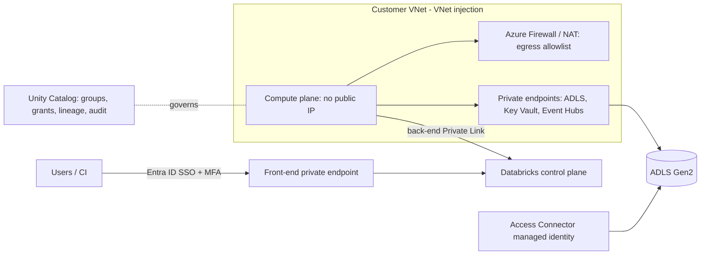

# 18. Security & Networking — VNet Injection, Private Link, IAM, RBAC vs ACLs

## 1. The architecture you are securing

Azure Databricks has two planes:

- **Control plane** (managed by Databricks): web application, REST APIs, job scheduler, notebook storage, cluster manager.
- **Compute plane:** where your data is actually processed.
  - **Classic compute plane:** clusters and classic SQL warehouses run as VMs in **your Azure subscription**, in your network.
  - **Serverless compute plane:** compute runs in a Databricks-managed network, with network policies and private connectivity controlled through account-level configuration.

Security design is about controlling: **who can reach the workspace** (front-end), **how compute reaches the control plane** (back-end), **how compute reaches data and the internet** (egress), and **who can do what** (identity and authorization).

## 2. Network isolation

### VNet injection
Deploy the workspace's classic compute into **your own virtual network** instead of a Databricks-managed one. You provide two dedicated subnets (commonly called the host/public and container/private subnets) delegated to `Microsoft.Databricks/workspaces`, with a network security group. Benefits:
- Connect to on-premises or other Azure resources through your own peering, VPN or ExpressRoute.
- Apply your own routing (user-defined routes), firewalls, and NSG rules.
- Control egress and enforce inspection.

Capacity planning matters: subnet size caps the number of nodes, so undersized subnets are a classic cause of cluster start failures.

### Secure cluster connectivity (No Public IP)
Cluster nodes have **no public IP addresses and no open inbound ports**; the compute plane opens an outbound connection to the control plane. This is the baseline for any enterprise deployment and is the default for new workspaces.

### Azure Private Link
Keeps traffic on the Microsoft backbone via private endpoints instead of the public internet:
- **Front-end Private Link:** users and API clients reach the workspace (web UI, REST API) through a private endpoint in your network.
- **Back-end Private Link:** compute plane reaches the control plane (cluster management, relay) via a private endpoint.
- **Storage and other services:** private endpoints for ADLS Gen2, Key Vault, Event Hubs, SQL, so data paths never traverse the public internet.

Private Link requires the Premium tier. For a fully private workspace you typically also **disable public network access** and manage DNS (private DNS zones) carefully, since misconfigured DNS is the most common cause of "workspace unreachable" problems.

### Serverless networking
Serverless compute reaches your storage and resources through account-level **network connectivity configurations** (private endpoint rules and stable egress addressing for firewall allowlists), plus network policies to restrict outbound access.

### Egress control and exfiltration prevention
Route outbound traffic through **Azure Firewall or a NAT gateway** with allowlists (package repositories, required Databricks endpoints, approved data sources); combine with Unity Catalog's storage governance so users cannot point compute at arbitrary storage.

### Other perimeter controls
- **IP access lists** limiting which source IPs can reach the workspace.
- **Private DNS** zones and conditional forwarding for hybrid environments.

## 3. Identity and access: the layers

| Layer | Question it answers | Mechanism |
|---|---|---|
| **Azure RBAC** | Who can create/manage the Azure *resources* (workspace, storage account, Key Vault)? | Azure roles (Owner, Contributor, Storage Blob Data Contributor, Key Vault Secrets User) on subscriptions/resource groups/resources |
| **Workspace permissions (ACLs)** | Who can use/manage *workspace objects* (clusters, jobs, notebooks, warehouses, secrets scopes)? | Per-object permission levels such as CAN USE, CAN RUN, CAN MANAGE, assigned to users/groups/service principals |
| **Unity Catalog privileges** | Who can read/write *data* and AI assets? | GRANT/REVOKE on catalogs, schemas, tables, volumes, external locations, plus row filters and column masks |
| **Storage-level ACLs** | Who can access *files* directly in ADLS? | Azure RBAC data roles and POSIX-style ACLs on ADLS Gen2 |

**RBAC vs ACLs, in one sentence:** RBAC is role-based control over *Azure resources* and broad data-plane access (coarse, inherited down the scope hierarchy), while ACLs are per-object permission lists (fine-grained, attached to individual workspace objects or storage paths).

With Unity Catalog, the recommended model is:
- Storage access is held by a **managed identity** (Access Connector) behind a storage credential and external location, **not by individual users**; users get *no direct* storage permissions.
- Data access is granted **in Unity Catalog** to **Entra ID groups**.
- This avoids managing POSIX ACLs per user on thousands of directories and makes access auditable in one place.

## 4. Identity management

- **Single sign-on with Entra ID**, with MFA and conditional access policies enforced at the identity provider.
- **Automatic identity management / SCIM provisioning:** sync users, groups and service principals from Entra ID to the Databricks account so joiners/movers/leavers are handled centrally.
- **Account-level identities** assigned to workspaces; avoid creating local users.
- **Service principals** for automation (jobs, CI/CD), never personal accounts; use OAuth or federation, not long-lived personal access tokens, and apply token policies and expiry.
- **Group-based grants** everywhere; individuals are never granted directly.

## 5. Data protection

- **Encryption at rest and in transit** by default; **customer-managed keys (CMK)** in Key Vault for managed services, managed disks and workspace storage where policy requires it.
- **Secrets** in Key Vault-backed secret scopes; no credentials in code or cluster configs.
- **Cluster policies** to constrain what users can create (approved runtimes, node types, init scripts, access modes), and enforce secure defaults such as Unity Catalog-enabled access modes.
- **Row filters and column masks** for sensitive data (PII).
- **Auditing:** audit logs and system tables (for example the audit and access tables) record who did what; feed them to Azure Monitor/Sentinel/SIEM and alert on anomalies such as mass downloads, permission changes and new external locations.

## 6. A reference secure design

*Diagram: users enter through a private front-end endpoint; compute runs without public IPs in your VNet, reaches the control plane and data over private endpoints, and egress is filtered; Unity Catalog and a managed identity govern data access.*

## 7. Common mistakes

- Granting data access to individuals instead of groups.
- Relying on storage ACLs per user while also using Unity Catalog (two sources of truth).
- Under-sized subnets for VNet injection.
- Enabling Private Link without planning DNS.
- Using personal access tokens in pipelines.
- Leaving public network access open "temporarily" and never closing it.
